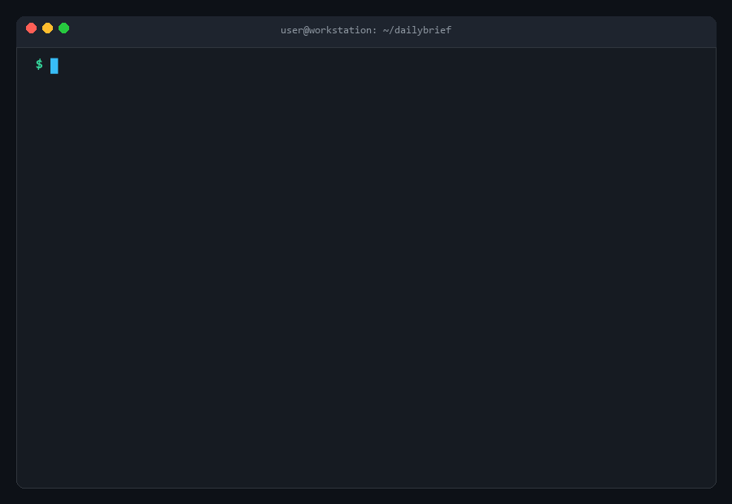

<div align="center">

# ⚡ DailyBrief

**Your personal AI executive developer assistant in the terminal.**  
Turn scattered daily notes, multi-repo Git activity, and persistent priorities into a crisp, high-signal briefing with chronic blocker detection.

[Türkçe Dokümantasyon (Turkish README)](README.tr.md) • [Report Bug](https://github.com/DrWellsy/dailybrief/issues) • [Request Feature](https://github.com/DrWellsy/dailybrief/issues)

[](https://python.org)
[](https://python.org)
[](https://github.com/DrWellsy/dailybrief)
[](LICENSE)
[](https://github.com/sponsors/DrWellsy)

<br/>



</div>

---

## 💡 Why DailyBrief?

As developers and builders, our work is fragmented across scratchpads, multiple Git repositories, and yesterday's deferred items. Reviewing 10 different files while recalling what you committed yesterday takes too much cognitive load before your first coffee.

**DailyBrief** is an autonomous terminal agent:
- 🛡️ **Local DLP & Secret Redaction Firewall:** Never leak credentials! Scans notes and git diffs before LLM transit, automatically neutralizing API keys (`sk-...`, `ghp_...`, `AIza...`), JWTs, database URLs, and private keys.
- 🔍 **Codebase `TODO` / `FIXME` Harvester:** Automatically scans inline comments in your code (`TODO:`, `FIXME:`, `HACK:`) prioritizing recently modified files so tasks in code never slip through the cracks.
- 📊 **Smart Context Budgeter & Cost Telemetry:** Truncates noisy lockfiles to prevent context overflow; prints a sleek footer showing exact latency (`⏱️ 1.2s`), token usage, and estimated USD cost (`💰 $0.0035`).
- 📈 **Weekly Sprint Retrospective (`--weekly`):** Synthesizes the last 7 days of Git commits and briefings into a Developer Velocity Score (%) and ready-to-share Friday sprint summary.
- 🚀 **Shell Auto-Greeting Hook (`--init-shell`):** Runs DailyBrief only once per day on your first morning terminal launch (0ms overhead on all subsequent tabs).
- 📦 **Zero-Python Standalone Binary:** Run anywhere on Windows (`.exe`), macOS, or Linux without needing Python installed.
- ⚡ **Sub-Second Parallel Engine & Zero-Token Smart Caching:** Parallel multi-file note ingestion & multi-repo Git inspection. Deterministic SHA-256 state caching serves instant briefings with `⚡ Loaded from instant cache (0 tokens used)`.
- ⏰ **Autonomous Background Scheduler (`--schedule 08:45`):** Automatically runs via native OS task scheduler (Windows Task Scheduler / cron), pre-warms cache, and sends native desktop notifications before you start work.
- 🩺 **System Self-Diagnostics (`--doctor`):** Comprehensive diagnostic check validating configuration, LLM reachability / local Ollama daemon, Git repos, and speech engine.
- 🔒 **Multi-LLM & 100% Local Private Mode:** Choose Anthropic Claude, OpenAI, Google Gemini, or run **100% offline with local Ollama** (`llama3.2`, `mistral`) with zero API keys or external data transfer.
- 🔌 **Native MCP (Model Context Protocol) Server:** Run `dailybrief --mcp` to connect your briefing, git context, and memory directly into AI IDEs (Cursor, Claude Desktop, Windsurf).
- 🌙 **End-of-Day Autonomous Reconciliation (`--eod`):** Closes the loop on your day. Reconciles morning priorities against git commits and notes into Completed, In Progress, and Carried Over tasks.
- ⚡ **Predictive Git Conflict & Upstream Radar:** Safely inspects upstream divergence (`HEAD..@{u}` / `origin/main`) without modifying working files, warning you of conflicting file edits before they become merge disasters.
- 🎙️ **Executive Voice Briefing (`--voice`):** Synthesizes a natural, conversational 30–45s spoken summary with smooth terminal audio playback for your morning coffee routine.
- 🐙 **Multi-Repo Git Sensing:** Watches one or multiple local repositories (`-g /path/to/repo`), aggregating branch status, recent commits (last 48h), and uncommitted working changes.
- ⚠️ **Chronic Blocker & Carry-Over Engine:** Cross-references priorities from consecutive days with Git activity, flagging lingering tasks with concrete unblocking advice.
- ⚡ **True Agentic Interactive Loop (`-i`):**
  - **`[c]` Copy Standup:** Copy clean, formatted bullet points to your clipboard for Slack / Teams.
  - **`[s]` Save Markdown:** Export briefing to `brief-YYYY-MM-DD.md`.
  - **`[b]` Break Down Task:** Choose a priority item and have the AI generate a 3-step technical implementation checklist saved to `tasks-YYYY-MM-DD.md`.
  - **`[g]` Checkout Branch:** Propose and automatically checkout a clean branch (e.g. `fix/login-session-timeout`) based on Priority #1.
  - **`[r]` Refine / Chat:** Type a natural language command (*"Drop task 2 and emphasize the auth bug"*) to dynamically update your brief and persist changes to memory.

---

## 🖥️ Sample Terminal Output

```text
╭─────────────────────────────────────────────────────────────────────────────╮
│                                 DailyBrief                                  │
│               Date: 2026-10-15  •  Provider: anthropic (claude)             │
╰─────────────────────────────────────────────────────────────────────────────╯
[Git] Watching 2 repo(s): dailybrief ('main', 3 commits), api ('feat/auth', 1 commit) | 2 uncommitted total
[Memory] Carried context from previous briefing (2026-10-14)

╭─ ⚠️ Blocker / Carry-Over Alert ─────────────────────────────────────────────╮
│ 1. Fix login session timeout bug before noon release [2 days carried over]  │
│    💡 This task has appeared across 2 consecutive briefings with zero       │
│       related git commits. Action: Break down into an initial 15-minute     │
│       subtask or file a GitHub blocker issue.                               │
╰─────────────────────────────────────────────────────────────────────────────╯

╭─ Daily Brief ───────────────────────────────────────────────────────────────╮
│                                                                             │
│ Key Priorities for Today                                                    │
│ 1. Fix login session timeout bug before noon release (Carried over)         │
│ 2. Finalize & publish v0.2.0 changelog to GitHub                           │
│ 3. Align with design team on onboarding copy adjustments                    │
│                                                                             │
│ Things Not to Forget / Follow-ups                                           │
│ • Standup status update at 10:30 AM (5-min prep)                            │
│ • Review analytics funnel conversion report at 16:00                        │
│ • Uncommitted changes in dailybrief/cli.py need tests before pushing        │
│                                                                             │
╰─────────────────────────────────────────────────────────────────────────────╯
Compiled from 3 file(s)

[c] Copy Standup  •  [s] Save MD  •  [b] Break Down  •  [g] Branch  •  [r] Refine  •  [Enter] Exit
>>
```

---

## 🚀 Installation

### 1. Zero-Python Standalone Binary (Recommended)
No Python installation or virtual environment required! Run one command in your terminal:

**macOS & Linux (Bash / Zsh):**
```bash
curl -fsSL https://raw.githubusercontent.com/DrWellsy/dailybrief/main/install.sh | bash
```

**Windows (PowerShell):**
```powershell
irm https://raw.githubusercontent.com/DrWellsy/dailybrief/main/install.ps1 | iex
```

*Or download the compiled standalone executable directly from [GitHub Releases](https://github.com/DrWellsy/dailybrief/releases):*
- **Windows x64:** `dailybrief-windows-x64.exe`
- **macOS Apple Silicon:** `dailybrief-macos-arm64`
- **Linux x64:** `dailybrief-linux-x64`

---

### 2. Python Package Managers (`uv` or `pipx`)

Using **`uv`**:
```bash
uv tool install git+https://github.com/DrWellsy/dailybrief.git
```

Using **`pipx`**:
```bash
pipx install git+https://github.com/DrWellsy/dailybrief.git
```

### 3. From Source

```bash
git clone https://github.com/DrWellsy/dailybrief.git
cd dailybrief
pip install -e .
```

---

## ⚙️ Configuration & Providers

DailyBrief stores settings in `~/.dailybrief/config.toml`. Run `dailybrief` once or edit the file directly:

```toml
# ~/.dailybrief/config.toml
provider = "anthropic"            # "anthropic", "openai", "gemini", or "ollama"
model = "claude-sonnet-4-6"       # Optional model override
watched_repos = [
    "/Users/dev/projects/dailybrief",
    "/Users/dev/projects/api-backend"
]

# Executive Voice Briefing Settings
voice_provider = "openai"         # "openai", "elevenlabs", or local offline fallback
voice_name = "alloy"              # "alloy", "echo", "fable", "onyx", "nova", "shimmer"
```

### 1. 100% Local & Private Mode (Ollama)
No API key required. Install and run [Ollama](https://ollama.ai):

```bash
# Pull your preferred model
ollama run llama3.2

# Run DailyBrief completely locally
dailybrief --provider ollama --model llama3.2
```

### 2. Cloud Providers (Anthropic, OpenAI, Gemini)
Set your environment variables or let DailyBrief prompt you on first run:

```bash
# Anthropic Claude (Default)
export ANTHROPIC_API_KEY="your_api_key"

# OpenAI GPT-4o & TTS
export OPENAI_API_KEY="your_api_key"
dailybrief --provider openai --model gpt-4o

# Google Gemini
export GEMINI_API_KEY="your_api_key"
dailybrief --provider gemini --model gemini-2.5-flash
```

---

## 🔌 MCP Server Integration (Cursor / Claude Desktop / Windsurf)

DailyBrief speaks native **Model Context Protocol (MCP)** over `stdio` via JSON-RPC 2.0. This allows AI code assistants to proactively inspect your morning brief, check branch health, and check off priorities.

### Setup in Cursor (`~/.cursor/mcp.json`) & Claude Desktop (`claude_desktop_config.json`)

Add this snippet to your MCP server configuration:

```json
{
  "mcpServers": {
    "dailybrief": {
      "command": "dailybrief",
      "args": ["--mcp"]
    }
  }
}
```

### Available Tools Exposed to Connected AI Agents:
1. **`get_daily_briefing`**: Returns today's structured priorities, follow-ups, and raw notes summary.
2. **`get_git_and_blocker_context`**: Provides active branch names, uncommitted working changes, and persistent blockers carried over from previous days.
3. **`mark_task_completed`**: Checks off an item in persistent memory with an optional completion note so tomorrow morning's briefing stays accurate.

---

## 🌙 End-of-Day Autonomous Reconciliation (`--eod`)

Close the loop on your workday with zero manual bookkeeping:

```bash
dailybrief --eod
```

### The Full-Circle Loop
1. **Morning (`dailybrief -i`):** Establishes your top 3 non-negotiable priorities.
2. **Workday:** You commit code across git repositories and check off `[x]` items in local scratchpads.
3. **Evening (`dailybrief --eod`):** Compares your morning brief against git commit logs, modified working files, and note updates since morning.

Tasks are automatically classified into:
- `✅ Completed Today`: Matched against your commits or checked off `[x]` notes.
- `🔄 In Progress`: Uncommitted file modifications or partial commits detected.
- `⏭️ Carried Over to Tomorrow`: Untouched items ready to roll over into tomorrow's briefing memory.

Press `[c]` to immediately copy a sleek Slack / Teams end-of-day update to your clipboard!

---

## 🎙️ Executive Voice Briefing (`--voice`)

Turn your morning terminal session into a 30–45 second spoken podcast for your coffee routine:

```bash
dailybrief --voice
```

- Cleans Markdown hashes, URLs, and tables into natural, conversational sentences.
- High-quality audio synthesis via OpenAI TTS (`alloy`, `echo`, `nova`, `shimmer`) or ElevenLabs.
- **Zero-Crash Offline Fallback:** If offline or without an API key, automatically utilizes native system text-to-speech (Windows SAPI / COM, macOS `say`, or Linux `espeak`).
- Displays a visual audio playing indicator with clean `Ctrl+C` handling to skip playback safely.

---

## ⚡ Predictive Git Conflict & Upstream Radar

Avoid merge disasters before writing a single line of code. DailyBrief passively inspects upstream divergence (`HEAD..@{u}` / `origin/main`):

```text
╭─ ⚡ Git Radar / Conflict Warning ───────────────────────────────────────────╮
│ ⚠️  2 commit(s) upstream on origin/main                                      │
│ Upstream modified: api/auth.py, tests/test_auth.py                          │
│ 🚨 High Conflict Risk: Local files modified or referenced in notes overlap! │
│ 💡 Advice: Pull or rebase upstream changes before continuing work.           │
╰─────────────────────────────────────────────────────────────────────────────╯
```

---

## ⚡ Sub-Second Parallel Engine & Zero-Token Smart Caching

Never wait for identical briefings or burn tokens unnecessarily:
- **Parallel Note & Git Ingestion:** Ingests dozens of notes and multi-repo Git states concurrently using multi-threaded I/O pools.
- **Deterministic SHA-256 State Hashing:** Hashes note contents + timestamps, Git commit logs, and configuration. If nothing changed, your briefing loads in <50ms:
  ```text
  ⚡ Loaded from instant cache (0 tokens used)
  ```
- **Bypass Cache:** Use `--force` anytime you want to trigger a fresh LLM generation.

---

## ⏰ Autonomous Morning Scheduler & Desktop Notifications

Have your daily briefing waiting for you before you sit at your desk:

```bash
# Schedule daily autonomous briefing at 08:45 AM
dailybrief --schedule 08:45

# Remove schedule anytime
dailybrief --unschedule
```

- **Native OS Scheduling:** Registers a native Windows Scheduled Task (`schtasks`) or macOS / Linux `crontab` entry.
- **Background Execution:** Silently reads notes, inspects Git, pre-warms the instant cache, saves `brief-YYYY-MM-DD.md`, and fires a native OS desktop notification:
  > *"⚡ Your DailyBrief is ready! Run `dailybrief` to view."*

---

## 🩺 System Self-Diagnostics (`dailybrief --doctor`)

Run an instant system health check to verify your setup:

```bash
dailybrief --doctor
```

```text
                    DailyBrief System Diagnostics (Doctor)                     
┌──────────┬──────────────────┬────────┬──────────────────┬───────────────────┐
│ Category │ Check            │ Status │ Details          │ Recommendation    │
├──────────┼──────────────────┼────────┼──────────────────┼───────────────────┤
│ Config   │ Config File      │ ✔ PASS │ ~/.dailybrief/…  │                   │
│ LLM      │ Anthropic Key    │ ✔ PASS │ Configured (sk-…)│                   │
│ Git      │ Git Executable   │ ✔ PASS │ git v2.54.0      │                   │
│ Git      │ Workspace Repo   │ ✔ PASS │ branch 'main'    │                   │
│ Notes    │ Notes Directory  │ ✔ PASS │ 5 notes found    │                   │
│ Cache    │ Content Cache    │ ✔ PASS │ 9 cached briefs  │                   │
│ Voice    │ Speech Engine    │ ✔ PASS │ Windows SAPI COM │                   │
└──────────┴──────────────────┴────────┴──────────────────┴───────────────────┘
```

---

## 💻 CLI Usage & Flags

```bash
dailybrief [OPTIONS]
```

| Flag | Description | Default |
|------|-------------|---------|
| `-s, --source <PATH>` | Directory containing `.md` and `.txt` notes | `./notes` |
| `-l, --lang <en\|tr>` | Output and interface language (`en` or `tr`) | `en` |
| `-p, --provider <name>` | LLM provider (`anthropic`, `openai`, `gemini`, `ollama`) | `anthropic` |
| `-m, --model <name>` | Model name override | provider default |
| `-g, --git-repo <PATH>` | Additional Git repo to watch (repeatable) | Current directory |
| `-i, --interactive` | Enable interactive agent actions loop | `false` |
| `--eod` | End-of-Day autonomous reconciliation mode | `false` |
| `--voice` | Executive spoken audio briefing with player | `false` |
| `--mcp` | Run as standard stdio Model Context Protocol (MCP) server | `false` |
| `--force` | Bypass instant cache and force fresh LLM generation | `false` |
| `--schedule <HH:MM>` | Schedule autonomous daily briefing at specified time | `None` |
| `--unschedule` | Remove active autonomous scheduled task | `false` |
| `--background` | Run in background mode with desktop notification | `false` |
| `--doctor` | Run comprehensive system self-diagnostics | `false` |
| `--redact-pii` | Mask email and IP addresses in addition to credentials | `false` |
| `--no-todos` | Disable codebase inline `TODO`/`FIXME` scanning | `false` |
| `--weekly` | Generate weekly sprint retrospective and velocity scorecard | `false` |
| `--init-shell <SHELL>` | Generate non-blocking shell auto-greeting hook (`bash`, `zsh`, `powershell`, `fish`) | `None` |
| `--no-git` | Disable Git activity sensing | `false` |
| `--no-history` | Disable previous briefing memory & blocker engine | `false` |
| `-h, --help` | Show command line options and exit | |

---

## 🧪 Testing

Run the full 136+ unit test suite:

```bash
pytest
```

---

## 📄 License

Distributed under the MIT License. See [LICENSE](LICENSE) for details.
